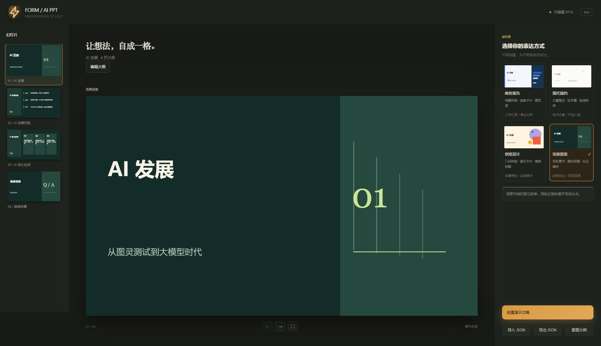
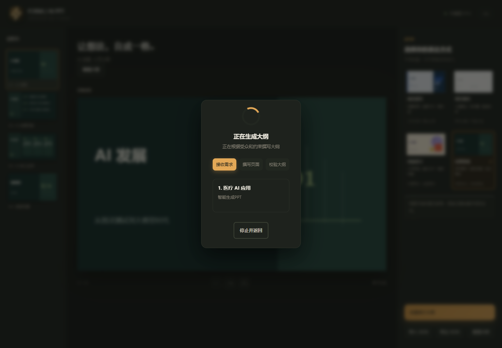
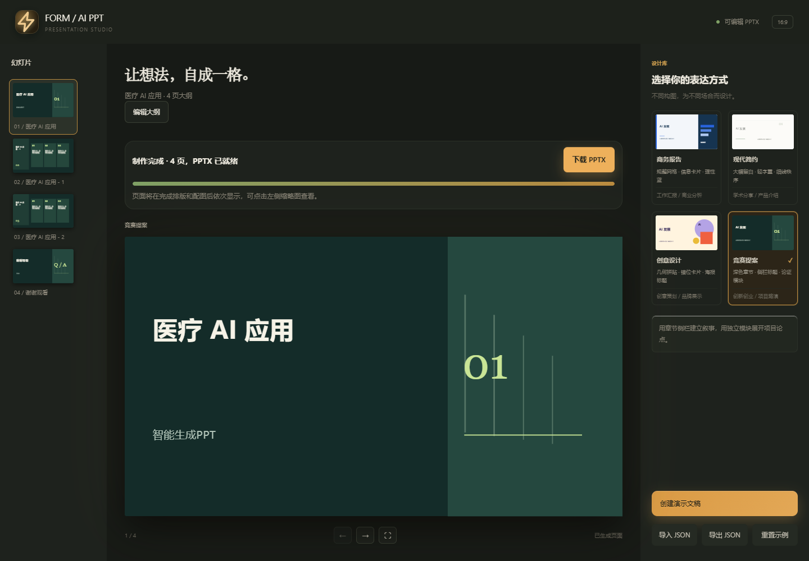

# FORM / AI PPT

一个基于 Flask 的演示文稿工作台：可编辑大纲 + 可编辑 PPTX 导出，帮你快速产出一份能用的 PPT 初稿。
A Flask presentation workspace with an editable outline and editable PPTX export — a fast first draft, not a finished deck.

> 声明：本作品在开发过程中使用了 AI 工具（Claude Code 等）辅助编写与审查代码。
> Note: this project was developed with the help of AI tools (Claude Code, etc.) for writing and reviewing code.

## 定位 / Positioning

适合：

- 课程作业、小组汇报、日常工作总结
- 内容框架清晰、不需要深度研究的小型演示
- 想先要个草稿再改，而不是从空白页开始

不适合：

- 学术论文答辩 / 期刊投稿 —— 数据、引用、结论需要自己逐条核对
- 竞赛路演、商业融资、对外正式发布 —— 版式与措辞需要深度定制
- 任何「错了后果很严重」的场景

---

Suitable for class assignments, routine reports and small presentations. **Not** a finished product for thesis defenses, competitions or public releases — data, citations, wording and layout there need your own review.

## 截图 / Screenshots

主工作区 / Main workspace：

<p align="center"></p>

AI 流式生成大纲 / Outline generation：

<p align="center"></p>

生成完成的 PPT / Generated deck：

<p align="center"></p>

## 快速开始 / Quick start

```powershell
python -m pip install -r requirements.txt
python app.py
```

打开 http://127.0.0.1:5000，在网页「API 密钥设置」里填 Key 即可；不填也能用占位大纲 / 纯排版（无费用）。

Open http://127.0.0.1:5000, set your API keys in the page. Works without keys too (placeholder outline / pure layout, no cost).

## 配置 / Configuration

参考 `.env.example`，或在网页「API 密钥设置」里填：

| 变量 | 用途 |
| --- | --- |
| `DEEPSEEK_API_KEY` | 大纲 / 文案生成（DeepSeek）· outline & copy generation |
| `VISION_API_KEY` | 图片视觉校验，可选 · optional vision check |
| `PROXY_URL` | 访问境外 API 的代理，可选 · optional proxy |
| `ACCESS_USERNAME` / `ACCESS_PASSWORD` | 局域网共享口令，可选 · optional LAN password |

## 许可证 / License

[MIT](LICENSE)
